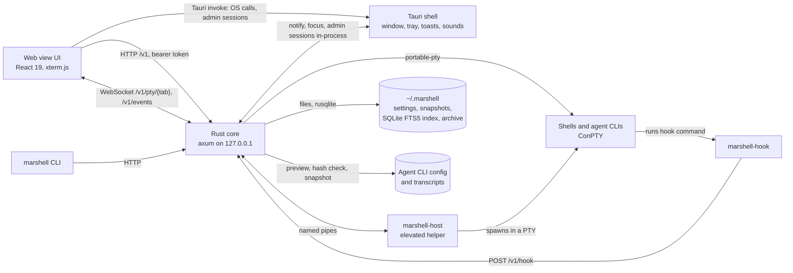

<p align="center"></p>

# Marshell

Marshell is a Windows desktop app for AI coding-agent CLIs. It gives Claude Code, Codex and other vendors' agents what the vendors' own desktop apps have (a session list with live status, approval cards, task worktrees, searchable history) while every agent stays a plain terminal.

Each AI vendor's desktop app manages that vendor's agent only. Marshell does that job for the CLIs, from any vendor, in one window. It leaves each CLI as it is: a program in a terminal, with its own sign-in and its own config files.

[](https://github.com/Doofess/marshell/actions/workflows/ci.yml)
[](https://github.com/Doofess/marshell/releases)
[](LICENSE)
[](#status)

<!-- SCREENSHOT: main window, dark theme. Three or four sessions in the sidebar with different statuses (one "needs you", one working, one done), a Claude Code terminal in the main area, and an approval card for a held permission request. Save as docs/images/main-window.png and replace this comment with the image and alt text. -->

## What it does

- Permission requests become cards. Marshell holds an agent's permission request through its hook and shows it as a card: allow once or deny, and for Claude Code also always allow in this project, unless the request is flagged risky or comes from an administrator session. Typing in that terminal hands the question back to the agent's own prompt, except for Antigravity, which has no prompt to hand it to.
- Live status for every session (working, needs you, done, error, context used), from each agent's hooks and status line. Claude Code, Codex CLI, Antigravity and Qwen Code have full adapters. GitHub Copilot CLI reports status through its hooks and status line but asks for permission in its own terminal. Cursor CLI, opencode, Amp, Grok, Kimi, aider and crush launch without hook status, and any other program runs as a plain shell.
- Agent config you can see and undo. A settings page has a section for each of Claude Code, Codex, Antigravity and Qwen Code, and a raw editor, and every write, including Marshell's own hooks, is a diff preview with a snapshot and an undo. Uninstalling takes Marshell's entries out of those files again and keeps the snapshots; in the installer test, Claude Code's `settings.json` came back byte for byte. A doctor lists MCP servers and skills with an estimated token cost and fixes or switches off existing entries; adding new ones from the app is not built.
- Real terminals: ConPTY sessions, shell integration for PowerShell, bash, zsh and fish, agents inside WSL, administrator sessions, a git worktree per task, and asciicast recordings.
- Searchable history. Claude Code, Codex and Qwen Code transcripts are archived with zstd and indexed with SQLite FTS5, so they outlive the CLI's own cleanup.
- Windows toasts and a different system sound per event kind, with quiet hours. A preview pane opens code, Markdown, images, PDF and HTML and sends a marked region of a PDF or image to the agent.

Marshell never presses Enter for you, never stores your CLI credentials, and calls no model itself.

## How it works

A Rust core (`crates/core`) runs an axum HTTP and WebSocket server on `127.0.0.1` inside the app process and owns the PTYs, sessions, adapters, config service, history and doctor. The React UI talks to it through that API, with one exception: administrator sessions are started, typed into and approved only through Tauri commands into the in-process core, and the token API refuses them. Tauri also handles the window, tray, toasts and pickers. Agent CLIs report back through `marshell-hook`, a small binary in their hook config.



`ts-rs` generates 188 Rust protocol types into `src/generated/`, and CI fails if they are stale. On the front end, each of the 37 folders in `src/features/` holds one area's components, state and tests, and `src/lib/api/` has a typed client module per API area. State lives in hooks and `useSyncExternalStore` stores, with no store library.

## Design decisions

- Tauri 2 as a thin shell over a protocol-first core. Tauri was picked over Electron for a small installer (the alpha's is 13.8 MB), fast startup and Rust for the PTY and config work; the HTTP/WebSocket boundary lets the core become a daemon later. The known risk is Linux, where other terminal projects report that WebKitGTK holds back repaints while the window is idle. The [webview gate](docs/spikes/S1-webview-gate.md) keeps Electron as the fallback shell, and only its Windows row has run.
- A loopback API guarded per a written [threat model](docs/adr/0001-threat-model.md) that names other local users, web pages and hostile repository content: random port, a 32-byte token per launch compared in constant time, `Host` and `Origin` checks, per-route body caps. The token lives in an owner-only folder, administrator sessions are not reachable with it at all, and same-user malware is declared out of scope.
- One write path for agent config ([`crates/core/src/config/`](crates/core/src/config)). Applying a diff needs the file hashes its preview showed, so an outside edit in between is a conflict, and a snapshot is taken first. JSON is edited through a CST so comments survive; the cost is that a file that does not parse is refused, not repaired.
- The hook bridge never blocks an agent when Marshell is not running: a 50 ms connect timeout and always exit 0, so a closed Marshell just misses the event. A held permission request ends under one lock ([`holds.rs`](crates/core/src/hooks/holds.rs)), so only one of the card, typing or the timeout wins. A crashed core restarts on a new port and token, at most three times a minute ([`supervisor.rs`](crates/core/src/supervisor.rs)).
- Backpressure in Rust: the PTY reader pauses when the UI is 1 MiB behind on acknowledgements, so a slow renderer slows the program instead of losing output. Sending a lone echo at once instead of batching it cut PowerShell typing latency at p95 from 21.7 ms to 7.5 ms on one Windows 11 machine ([measurements](docs/spikes/S1-webview-gate.md)).

## Built with

| Layer | Technology |
|---|---|
| Desktop shell | Tauri 2, WebView2 |
| Core | Rust 1.98.1 (edition 2024), tokio, axum, portable-pty, vt100, rusqlite with FTS5, jsonc-parser, toml_edit, ts-rs |
| Front end | React 19, TypeScript 7, Vite 8, xterm.js 6 with WebGL, shiki, pdf.js, markdown-it with DOMPurify |
| Tests | cargo test, Vitest 5, Storybook 10 with the a11y addon |
| Packaging | NSIS per-user installer, ConPTY from NuGet pinned by SHA-512 |

## Testing and quality

- Rust: 2,955 `#[test]` and `#[tokio::test]` functions and 52 integration-test files. Hook tests replay 79 hook and status-line bodies recorded from the five real CLIs.
- TypeScript: 421 Vitest files with about 4,500 cases (grep for `it(` and `test(`). 39 tests read the stylesheets, for example to check that a component uses design tokens only. 30 Storybook stories.
- CI runs on every push to `main` and every pull request, on Windows: rustfmt, clippy with warnings as errors, all tests, the generated-types check, `tsc --noEmit`, a Tauri build and two 50 MB throughput tests.
- The release workflow installs the build, reinstalls it over the running app the way an update does, and uninstalls it before publishing.

## Try it

Download `Marshell_0.1.0-alpha.1_x64-setup.exe` from the [v0.1.0-alpha.1 pre-release](https://github.com/Doofess/marshell/releases/tag/v0.1.0-alpha.1) and run it. It needs Windows 11 x64 and no administrator rights. The build is unsigned: at the SmartScreen warning, choose More info, then Run anyway. The release page has the installer's SHA-256 file, the steps for updating and what uninstalling removes.

### Develop

You need Windows 11, Rust 1.98.1 (pinned in `rust-toolchain.toml`), Node 24, pnpm 12.10.1 and WebView2.

```sh
pnpm install
pnpm fetch:conpty   # once: downloads the pinned ConPTY build
pnpm tauri dev      # run the app
```

```sh
cargo test --workspace
pnpm test
pnpm build
pnpm check:generated
```

## Status

- Alpha, Windows 11 x64 only, with no auto-update.
- Linux and macOS are planned. CI runs on Windows only, and the sounds and the browser pane use Windows APIs.
- Cross-device sessions and GitHub sign-in exist only as a [design document](docs/research/2026-10-22-accounts-and-cross-device.md).

## Where it is going

- Workflows across vendors. Today the built-in `marshell` skill and command let an agent in one session list the others, start a session with another vendor's CLI and put a prompt on its line; you still press Enter. The goal is a workflow you define once that hands its steps to agents from different vendors.
- One place for every agent's tools. Today the settings page and the doctor cover four CLIs: they list MCP servers and skills, switch them off, and preview and undo every write. The goal is to manage plugins, skills, MCP servers and hooks for all vendors together and keep them in step across vendors, at user level and per project.
- Lower token use. Today the doctor estimates what each MCP server and skill costs in tokens and flags the unused ones. The goal is for the `marshell` skill to carry a working method that spends fewer tokens: a main agent that plans and hands the work to cheaper worker agents, as in [claude-setup](https://github.com/Doofess/claude-setup).
- A CLI manager: see which agent CLIs are on the PC and which are not, and install or update them from Marshell. Not built.

## How it was built

Built with AI coding agents. The plan and the decisions taken slice by slice are in [docs/PLAN.md](docs/PLAN.md).

## License

[MIT](LICENSE). Notices for bundled components are in [THIRD_PARTY_NOTICES.md](THIRD_PARTY_NOTICES.md). To report a vulnerability, see [SECURITY.md](SECURITY.md).
